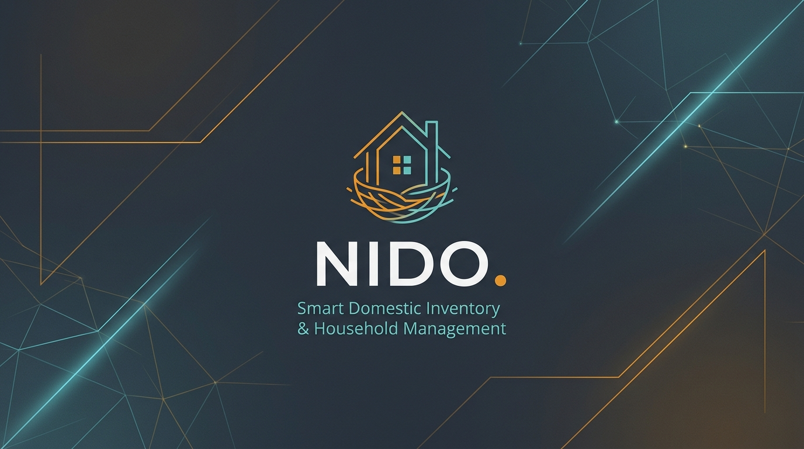
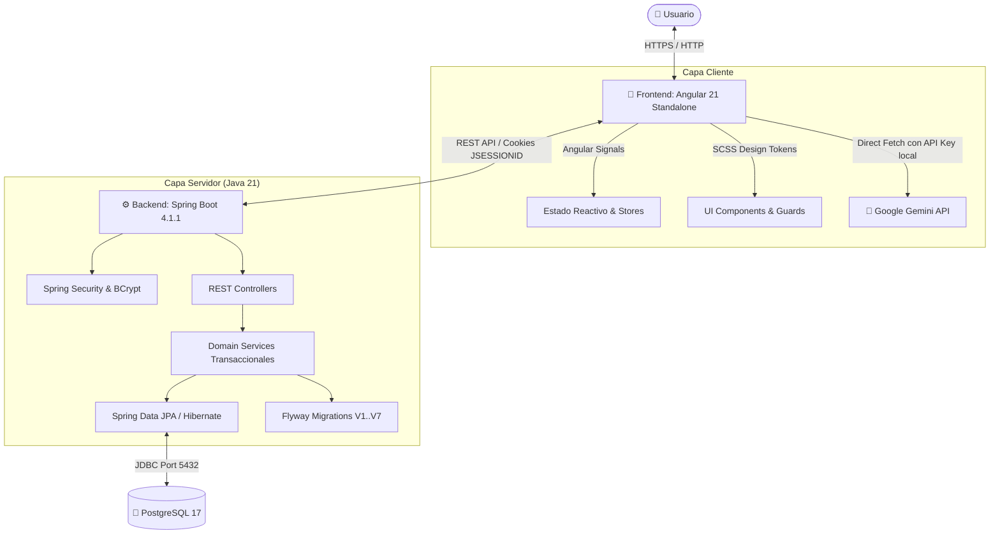

<div align="center">
  

  <br />

  <p>
    <a href="https://github.com/aliciiasarrio/NIDO/actions/workflows/ci.yml">
      
    </a>
    
    
    
    
    
    
    <a href="LICENSE">
      
    </a>
  </p>

  <p>
    <strong>NIDO</strong> es una plataforma web <em>Full-Stack</em> moderna, reactiva e intuitiva diseñada para el control inteligente del hogar: saber qué tienes, cuánto tienes, dónde está guardado, qué caduca pronto y qué necesitas comprar o cocinar hoy.
  </p>

  <p>
    <a href="#-funcionalidades-principales">Características</a> •
    <a href="#-arquitectura-del-sistema">Arquitectura</a> •
    <a href="#-inicio-rápido">Inicio Rápido</a> •
    <a href="#-referencia-de-la-api-rest">API REST</a> •
    <a href="#-documentación-adicional">Documentación</a> •
    <a href="#-autora">Autora</a> •
    <a href="#-licencia">Licencia</a>
  </p>
</div>

---

## ✨ Funcionalidades Principales

<table>
  <tr>
    <td width="50%">
      <h3>🔐 Autenticación y Multi-Hogar</h3>
      <ul>
        <li>Cifrado seguro con <b>BCrypt</b> y sesiones HTTP (<code>JSESSIONID</code>) orquestadas con <b>Spring Security</b>.</li>
        <li>Soporte para múltiples hogares por usuario con roles de <b>Propietario</b> (<code>OWNER</code>) y <b>Miembro</b> (<code>MEMBER</code>).</li>
        <li>Generación de códigos de invitación únicos (expiración a los 7 días) para vincular convivientes de forma privada y sin emails externos.</li>
        <li>Rutas protegidas en el cliente mediante <code>authGuard</code>.</li>
      </ul>
    </td>
    <td width="50%">
      <h3>🗺️ Ubicaciones Jerárquicas</h3>
      <ul>
        <li>Organización en árbol de espacios anidados (<i>Cocina &gt; Armario superior &gt; Balda 2</i>).</li>
        <li>Generación y actualización automática de ruta completa (<code>fullPath</code>).</li>
        <li>Algoritmo de <b>detección y prevención de ciclos</b> y validación que impide archivar ubicaciones con dependencias activas.</li>
      </ul>
    </td>
  </tr>
  <tr>
    <td width="50%">
      <h3>📦 Inventario y Trazabilidad</h3>
      <ul>
        <li>Clasificación por categorías: <i>Alimentos, Limpieza, Ropa, Vajilla, Otros</i>.</li>
        <li>Distinción entre consumibles y duraderos con existencias desglosadas por ubicación, lote y fecha de caducidad.</li>
        <li>Atributos específicos para prendas (talla, color) y registro del último uso.</li>
        <li>Movimientos atómicos: <b>Entrada</b> (<code>ENTRY</code>), <b>Consumo</b> (<code>EXIT</code>), <b>Traslado</b> (<code>TRANSFER</code>) y <b>Ajuste</b> (<code>ADJUSTMENT</code>).</li>
      </ul>
    </td>
    <td width="50%">
      <h3>🛒 Compra Sincronizada</h3>
      <ul>
        <li>Detección y sugerencia automática de productos que caen bajo su <b>stock mínimo</b>.</li>
        <li><b>Registro de compra recibida</b>: descuenta lo pendiente e ingresa automáticamente las existencias al inventario en la ubicación elegida.</li>
        <li>Añadido de ingredientes faltantes con un solo clic desde el recetario.</li>
      </ul>
    </td>
  </tr>
  <tr>
    <td width="50%">
      <h3>🍳 Recomendador de Recetas Inteligente</h3>
      <ul>
        <li>Motor de sugerencias basado en los ingredientes reales disponibles en la despensa.</li>
        <li>Priorización de recetas con <b>alimentos próximos a caducar</b> para reducir el desperdicio.</li>
        <li>Indicador visual de ingredientes disponibles y faltantes.</li>
      </ul>
    </td>
    <td width="50%">
      <h3>👗 Armario Sostenible (Economía Circular)</h3>
      <ul>
        <li>Monitorización de prendas inactivas según ventanas temporales configurables (30 a 365 días).</li>
        <li>Botón de registro de uso en la fecha actual.</li>
        <li><b>Generador automático de fichas</b> para venta de segunda mano (<i>Vinted / Wallapop</i>) o donación con copia directa al portapapeles.</li>
      </ul>
    </td>
  </tr>
  <tr>
    <td colspan="2">
      <h3>🤖 Asistente Inteligente con IA (Google Gemini)</h3>
      <ul>
        <li>Panel conversacional integrado impulsado por modelos <b>Gemini 2.0 Flash / 1.5 Flash</b>.</li>
        <li>Asesoramiento en tiempo real: optimización de compras, combinación de outfits, recetas creativas con sobrantes y trucos de organización del hogar.</li>
        <li>Gestión segura de credenciales en local (<code>localStorage</code>) con descubrimiento dinámico y tolerante a fallos de modelos disponibles.</li>
      </ul>
    </td>
  </tr>
</table>

---

## 🏗️ Arquitectura del Sistema



---

## 🛠️ Stack Tecnológico

| Capa | Tecnologías |
| :--- | :--- |
| **Backend** | Java 21 LTS, Spring Boot 4.1.1, Spring Data JPA, Spring Security, Flyway, Maven |
| **Frontend** | Angular 21, TypeScript, Vanilla SCSS (Tokens HSL, Responsive), Angular Signals, Vitest |
| **Base de Datos** | PostgreSQL 17 |
| **Contenedores** | Docker Compose, Multi-stage Dockerfiles (Eclipse Temurin JRE Alpine + Nginx Alpine) |
| **Inteligencia Artificial**| Google Gemini API (Modelos 2.0 Flash / 1.5 Flash) |
| **CI / CD** | GitHub Actions (Maven, Spring Boot Tests, Angular Builds, Headless Vitest) |

---

## 🚀 Inicio Rápido

### Opción A: Despliegue Completo en 1 Comando con Docker (Recomendado) 🐳

No necesitas tener instalado Java, Node ni PostgreSQL en tu máquina. Solo requiere tener [Docker Desktop](https://www.docker.com/products/docker-desktop/) en ejecución:

```bash
# 1. Clonar el repositorio
git clone https://github.com/aliciiasarrio/NIDO.git
cd NIDO

# 2. Iniciar todos los servicios (Base de Datos + Backend + Frontend Nginx)
docker compose up -d --build
```

Una vez finalizado el arranque:
- 🌐 **Aplicación Web**: [http://localhost:4200](http://localhost:4200)
- ⚙️ **Backend REST API**: [http://localhost:8080/api](http://localhost:8080/api)

Para detener la aplicación:
```bash
docker compose down
```

---

### Opción B: Entorno de Desarrollo Local 💻

Si prefieres ejecutar y depurar los proyectos directamente en tu entorno:

#### 1. Requisitos previos
- **Java 21** (`java -version`)
- **Node.js 20+** y **npm** (`node -v`, `npm -v`)
- **Docker** para la base de datos

#### 2. Variables de entorno
Crea tu archivo `.env` en la raíz (puedes copiar el ejemplo):
```bash
cp .env.example .env
```

#### 3. Iniciar la base de datos PostgreSQL
```bash
docker compose up -d db
```

#### 4. Iniciar el Backend
```powershell
cd backend
$lines = Get-Content ..\.env; foreach ($line in $lines) { $p = $line.Split('=', 2); if ($p.Length -eq 2) { Set-Item -Path ('env:' + $p[0].Trim()) -Value $p[1].Trim() } }
.\mvnw.cmd spring-boot:run
```

#### 5. Iniciar el Frontend
En otra consola:
```powershell
cd frontend
npm install
npm start
```
Abre tu navegador en [http://localhost:4200](http://localhost:4200). Las peticiones a `/api/**` se redirigen automáticamente al puerto `8080` gracias al proxy integrado.

> 💡 **Guía detallada paso a paso:** Consulta [docs/local-setup.md](docs/local-setup.md) para más opciones de configuración en Windows, Linux y macOS.

---

## 📡 Referencia de la API REST

Los principales recursos REST expuestos por el Backend de NIDO se detallan a continuación:

| Módulo | Método | Endpoint | Descripción |
| :--- | :--- | :--- | :--- |
| **Auth** | `POST` | `/api/auth/register` | Registro de nuevo usuario (BCrypt) |
| | `POST` | `/api/auth/login` | Inicio de sesión con cookie `JSESSIONID` |
| | `POST` | `/api/auth/logout` | Cierre de sesión e invalidación de sesión |
| | `GET` | `/api/auth/me` | Consulta del perfil autenticado actual |
| **Hogares** | `GET` | `/api/households` | Lista de hogares del usuario |
| | `POST` | `/api/households` | Crear un nuevo hogar (`OWNER`) |
| | `POST` | `/api/households/{id}/invitations` | Generar código de invitación temporal (7 días) |
| | `POST` | `/api/households/join` | Unirse a un hogar existente con código |
| **Ubicaciones** | `GET` | `/api/locations` | Listado y jerarquía de ubicaciones del hogar |
| | `POST` | `/api/locations` | Crear ubicación (raíz o anidada con `parentId`) |
| **Inventario** | `GET` | `/api/items` | Catálogo de productos y existencias |
| | `POST` | `/api/items` | Crear nuevo producto / prenda de ropa |
| | `POST` | `/api/items/movements` | Registrar movimiento (`ENTRY`, `EXIT`, `TRANSFER`, `ADJUSTMENT`) |
| **Compra** | `GET` | `/api/shopping-list` | Lista de compra activa |
| | `POST` | `/api/shopping-list` | Añadir o actualizar artículo en lista |
| | `POST` | `/api/shopping-list/purchase-entry` | Ingresar compra completada al inventario |
| **Recetas** | `GET` | `/api/recipes/recommendations` | Sugerencias de recetas con ingredientes disponibles |
| **Dashboard** | `GET` | `/api/dashboard/summary` | Métricas y alertas en tiempo real del hogar |

---

## 📁 Estructura del Repositorio

```text
NIDO/
├── .github/                # Automatización CI/CD y plantillas de incidencias / PRs
│   ├── workflows/ci.yml    # Pipeline automatizado de testeo y compilación
│   ├── ISSUE_TEMPLATE/     # Plantillas para bugs y propuestas
│   └── pull_request_template.md
├── backend/                # API REST con Spring Boot 4 y Java 21
│   ├── src/main/java/      # Lógica de dominio, seguridad y controladores
│   ├── src/main/resources/ # Migraciones Flyway (V1..V7) y propiedades
│   └── Dockerfile          # Imagen Docker multi-etapa
├── frontend/               # Cliente web interactivo con Angular 21 Standalone
│   ├── src/app/            # Componentes, servicios reactivos y modelos
│   ├── nginx.conf          # Servidor Nginx con proxy inverso y fallback SPA
│   └── Dockerfile          # Imagen Docker multi-etapa
├── docs/                   # Documentación técnica de arquitectura y diseño
│   ├── data-model.md       # Diagrama de entidades relacionales y restricciones
│   ├── local-setup.md      # Guía extendida de despliegue y desarrollo local
│   ├── requirements.md     # Especificación de requisitos del sistema
│   └── implementation-plan.md
├── scripts/                # Herramientas de utilidad y datasets de prueba
│   ├── seed-moixent.sql    # Dataset de demostración integral
│   └── update_images.py    # Generador de iconos SVG vectorizados
├── compose.yaml            # Orquestación de contenedores Docker
├── .env.example            # Plantilla de variables de entorno segura
├── CONTRIBUTING.md         # Convenios de ramas, commits y código
├── SECURITY.md             # Política de seguridad y reporte de vulnerabilidades
└── LICENSE                 # Licencia MIT
```

---

## 📚 Documentación Adicional

- 📐 [Modelo de Datos Relacional y Tablas](docs/data-model.md)
- ⚙️ [Guía Detallada de Configuración y Ejecución](docs/local-setup.md)
- 📋 [Requisitos Funcionales y No Funcionales](docs/requirements.md)
- 🗺️ [Plan de Implementación y Seguimiento](docs/implementation-plan.md)
- 🗄️ [Scripts y Datos de Demostración](scripts/README.md)
- 🎨 [Documentación Técnica del Frontend](frontend/README.md)
- ⚙️ [Documentación Técnica del Backend](backend/README.md)

---

## 👩‍💻 Autora

Desarrollado por **[Alicia Sarrío](https://github.com/aliciiasarrio)** — *Ingeniera Informática (UPV) & Full-Stack Developer*.  
💼 **LinkedIn:** [alicia-sarrío](https://www.linkedin.com/in/alicia-sarri%C3%B3-4b6b6633a/) | 📧 **Contacto:** [sarriocolomaralicia@gmail.com](mailto:sarriocolomaralicia@gmail.com)

---

## 🤝 Contribuciones

Las contribuciones son bienvenidas. Si deseas colaborar:
1. Revisa nuestra [Guía de Contribución](CONTRIBUTING.md).
2. Consulta nuestra [Política de Seguridad](SECURITY.md).
3. Abre una *Issue* para comentar la propuesta antes de iniciar cambios grandes.

---

## 📄 Licencia

Este proyecto se distribuye bajo la licencia **MIT**. Para más información, consulta el archivo [LICENSE](LICENSE).
